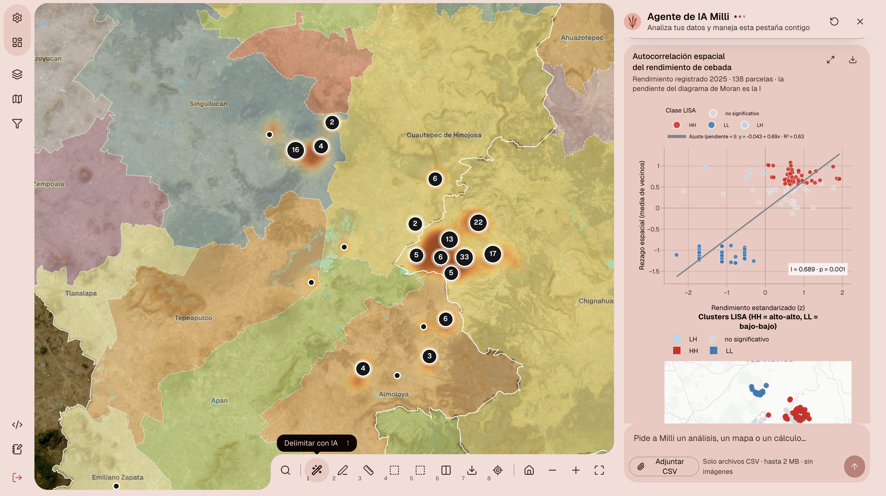

# AgroCebada · FIRA 2026

Aplicativo web para el reto **AgroCebada de FIRA 2026**: estimación del rendimiento (t/ha) de cebada maltera de temporal en Hidalgo, Puebla y Tlaxcala, ciclo abril–octubre de 2025. Combina un mapa interactivo de parcelas con imágenes satelitales y un agente de IA, **Milli**, que analiza los datos, genera gráficas y maneja la pestaña contigo a través de MCP.



## Qué incluye

- **Mapa** (React + OpenLayers): las 197 parcelas del reto, municipios, clima, topografía, Landsat, Sentinel-2 (RGB, NDVI, MNDWI) y AlphaEarth.
- **Estimar**: métricas del modelo (MAE 0.322, RMSE 0.487 t/ha, R² 0.670 en validación cruzada de 5 particiones sobre 138 parcelas), intervalos empíricos y el CSV de entrega de 59 filas por `ID_POLIGONO`.
- **Agente de IA Milli**: chat por pestaña con herramientas MCP para datos, estadística, figuras y control del mapa, más un RAG en español sobre cebada, clima, teledetección y el propio reto.
- **Delimitar con IA**: SAM 2.1 propone el contorno de una parcela a partir de unos cuantos clics.

## Uso

```sh
npm ci
npm run dev        # http://localhost:8080
```

Pruebas: `npm run check`, `npm test` y `npm run test:e2e`.

## Créditos

- **Desarrollo**: [dotrdp](https://github.com/dotrdp).
- **Datos del reto**: FIRA (Fideicomisos Instituidos en Relación con la Agricultura), con las parcelas, rendimientos, clima y proyecto QGIS originales.
- **Imágenes y cartografía**: ESA Copernicus Sentinel-2 vía Microsoft Planetary Computer; USGS Landsat Collection 2; Google AlphaEarth Foundations (CC BY 4.0); INEGI Marco Geoestadístico; mapas base de Esri y [OpenFreeMap](https://openfreemap.org) © OpenMapTiles © colaboradores de OpenStreetMap.
- **Modelos**: SAM 2.1 de Meta AI para la delimitación; DeepSeek como modelo de lenguaje de Milli.
- **Interfaz**: [React](https://react.dev), [OpenLayers](https://openlayers.org), [shadcn/ui](https://ui.shadcn.com), Radix, Tailwind CSS, [assistant-ui](https://www.assistant-ui.com), Recharts, Plotly, TanStack Table, [COBE](https://github.com/shuding/cobe), [Spectrum UI](https://ui.spectrumhq.in), Magic UI, Intent UI, Stealth UI y la tipografía [Geist](https://vercel.com/font). Las licencias de terceros están en `public/licenses/`.
- **Búsqueda en el RAG**: [tgrep](https://github.com/microsoft/tgrep) de Microsoft.

## Citas

1. Ravi, N., Gabeur, V., Hu, Y.-T., Hu, R., Ryali, C., Ma, T., *et al.* (2024). *SAM 2: Segment Anything in Images and Videos*. arXiv:2408.00714. <https://github.com/facebookresearch/sam2>
2. Brown, C. F., Kazmierski, M. R., Pasquarella, V. J., *et al.* (2025). *AlphaEarth Foundations: An embedding field model for accurate and efficient global mapping from sparse label data*. arXiv:2507.22291.
3. Xu, H. (2006). Modification of normalised difference water index (NDWI) to enhance open water features in remotely sensed imagery. *International Journal of Remote Sensing*, 27(14), 3025–3033.
4. Rouse, J. W., Haas, R. H., Schell, J. A., & Deering, D. W. (1974). Monitoring vegetation systems in the Great Plains with ERTS. *Third ERTS Symposium*, NASA SP-351, 309–317.
5. Moran, P. A. P. (1950). Notes on continuous stochastic phenomena. *Biometrika*, 37(1/2), 17–23.
6. Anselin, L. (1995). Local Indicators of Spatial Association — LISA. *Geographical Analysis*, 27(2), 93–115.
7. European Space Agency. *Sentinel-2 Level-2A products*. Copernicus SentiWiki. <https://sentiwiki.copernicus.eu/web/s2-products>
8. Microsoft. *Planetary Computer: Sentinel-2 L2A y Landsat Collection 2 Level-2*. <https://planetarycomputer.microsoft.com>
9. U.S. Geological Survey. *Landsat Collection 2 Level-2 Science Products*. <https://www.usgs.gov/landsat-missions/landsat-collection-2-level-2-science-products>
10. INEGI. *Marco Geoestadístico*. <https://www.inegi.org.mx/temas/mg/>
11. Anthropic (2024). *Model Context Protocol*. <https://modelcontextprotocol.io>
